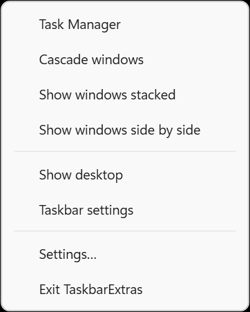
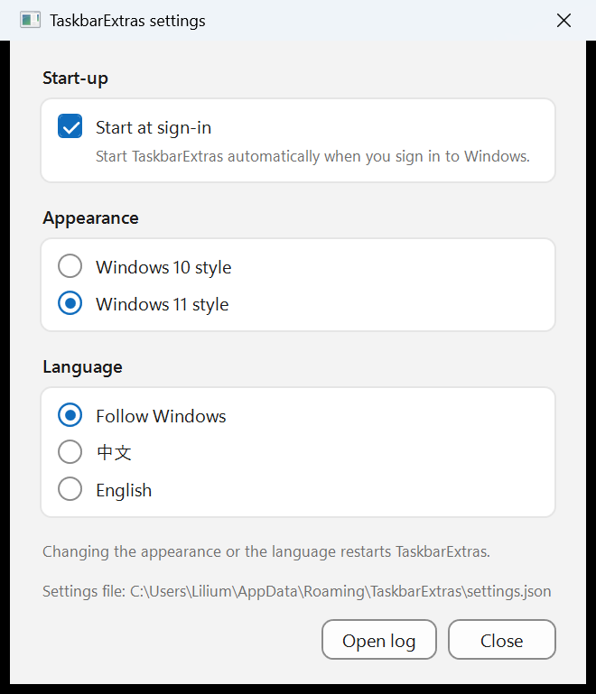
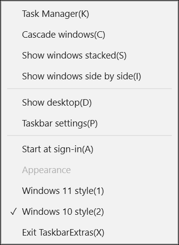
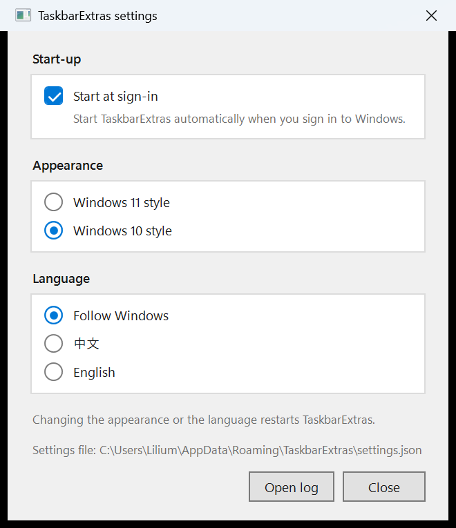

# TaskbarExtras

**English** · [简体中文](README.md)

Windows 11 threw away most of the taskbar right-click menu. This puts it back.



## How this started

Left hand holding a drink, right hand just off the keyboard, and I wanted the desktop.

`Win+D` needs a hand I didn't have. So I did the obvious thing and right-clicked the taskbar for **Show desktop**.

It's gone. Windows 11 removed it.

Microsoft, what are you doing 😡

Fine. I'll do it myself. ε=( o｀ω′)ノ

## What you get

Right-click the taskbar's empty background:

| | |
|---|---|
| Task Manager | |
| Cascade windows | |
| Show windows stacked | |
| Show windows side by side | |
| Show desktop | Minimise everything; click again to restore |
| Taskbar settings | |
| Settings… | Opens this app's settings panel |
| Exit TaskbarExtras | |

The first six are this app's own version of the Windows 10 taskbar menu, in two groups: the first four **rearrange windows that are already open**, and the pair below the separator is something else — one hides them all, the other is a settings entry point. **Settings… / Exit** did not exist in Windows 10, so they sit below the last separator.

> A word about fidelity: Windows 10's real taskbar menu is `Toolbars / Search / Show Task View button / Show open windows / Task Manager / Lock the taskbar / Properties` — it manages **system toggles** and contains no window-arranging items at all. What this app implements is the window-arranging set, closer to the Windows 7 era taskbar menu. The two do not correspond item for item; that is a deliberate choice about function, not an oversight.

Only the **empty** part of the taskbar is intercepted. Right-clicking Start still gives you Win+X, right-clicking a task button still gives you its jump list, right-clicking a tray icon still gives you its own menu. None of that is touched.

## Settings

The **Settings…** row opens an ordinary settings window:



Three groups: **Start-up** (start at sign-in), **Appearance** (Win11 / Win10 style) and **Language** (follow Windows / 中文 / English). Changing the appearance or the language restarts the app — see "Skins" below for why.

The bottom of the window names the settings file and offers **Open log**.

The panel is skinned too, so it follows the skin: pick the Windows 10 style and the panel goes square, flat, and Windows 10 blue.

The tray icon's own menu carries a **Settings…** entry as well. That duplication is deliberate — whether the main menu opens at all depends on the mouse hook having installed, and the tray route does not.

## Running it

Grab it from [Releases](../../releases), or build it:

```bash
dotnet publish src/TaskbarExtras.App -c Release -r win-x64 --self-contained true \
  -p:PublishSingleFile=true -p:IncludeNativeLibrariesForSelfExtract=true \
  -p:EnableCompressionInSingleFile=true -o publish
```

One exe comes out. Double-click it. No admin rights, no .NET install needed.

```
TaskbarExtras.exe                     start
TaskbarExtras.exe --settings          open the settings panel
TaskbarExtras.exe --quit              ask a running instance to stop
TaskbarExtras.exe --autostart         report whether it starts at sign-in
TaskbarExtras.exe --autostart on|off  turn that on or off
TaskbarExtras.exe --lang zh|en        force the UI language (defaults to your system)
TaskbarExtras.exe --skin win11|win10  menu appearance for this run only
TaskbarExtras.exe --skin-set win11|win10
                                      change the default and remember it
                                      (takes effect on the next launch)
TaskbarExtras.exe --preview           show the menu once, for trying out a skin
TaskbarExtras.exe --help              print this
```

With an instance already running, `--settings` hands the request to it rather than starting a second process.

## Quitting

There's no main window, so there's nothing to close. Three ways out:

1. Right-click the taskbar → **Exit TaskbarExtras** (last row of the menu)
2. Right-click the tray icon → Exit. It lives in the `^` overflow flyout — a dark square with three bars.
3. `TaskbarExtras.exe --quit`

## Starting at sign-in

Right-click the taskbar → **Settings…** → tick **Start at sign-in**.

Or from the command line:

```bash
TaskbarExtras.exe --autostart on
TaskbarExtras.exe --autostart off
```

It writes to `HKCU\Software\Microsoft\Windows\CurrentVersion\Run` — per-user, no admin rights.

One thing worth knowing: Task Manager's Startup tab can disable an entry **without deleting it**. It records that decision somewhere else entirely, so the Run key keeps looking perfectly healthy while nothing ever starts. This app reads both, which is why disabling it there clears the tick in the panel, and ticking it again turns it back on for real.

Related: if you move the exe, the old registration points at a path that no longer exists. That also shows as unticked, and ticking it re-registers wherever the app is now.

## Skins

Everything the menu looks like lives in a `ResourceDictionary`. A new skin is a new xaml file, no C# changes.

| win11 (default) | win10 |
|---|---|
|  |  |

The two are modelled on the real thing from their own era rather than being one design recoloured:

- **win11**: near-white card, 8 px corners, soft shadow, neutral grey hover.
- **win10**: flat `#F2F2F2`, **square corners**, a darker grey border, and the shortcut letter written into the label — `Task Manager(K)`. **Those letters actually work**; they are not decoration.

### Switching

**Right-click the empty taskbar → Settings… → Appearance → pick one.** It restarts itself.

Two command-line flags, differing only in whether they remember:

```bash
TaskbarExtras.exe --skin-set win10    # change the default and remember it
TaskbarExtras.exe --skin win10        # this run only, default untouched
```

The choice is stored in `%APPDATA%\TaskbarExtras\settings.json` and survives restarts.

**Why does switching restart the process?** The skin is a dictionary merged in before the menu window is constructed, and the window's brushes reference it with `StaticResource` — resolved once at load, so swapping the dictionary underneath a live window does nothing. A switch in place would mean converting every brush reference to `DynamicResource`. A restart costs about 300 ms. The language is the same story: the menu rebuilds its labels on every open and would follow along, but the tray menu's labels are fixed when the icon is created, and half-applying it is worse than restarting.

The panel uses the same skin, so the two skins give two different-looking panels:

| Settings panel, win11 | Settings panel, win10 |
|---|---|
|  |  |

## Two rules

**Nothing gets injected.** No DLL into `explorer.exe`, no patching, no touching system files. It's an ordinary process. Close it and nothing is left behind.

**Documented APIs only.** The right-click is intercepted with `WH_MOUSE_LL`, in our own process. Window arrangement goes through `IShellDispatch`. The taskbar geometry comes from `SHAppBarMessage` and `GetMonitorInfo`. No private struct offsets, no byte signatures.

The reason is practical: tools built on injection have to be rewritten every time Windows updates, and when they fall behind they break. The measurements and the reasoning are in [docs/DESIGN.md](docs/DESIGN.md).

## Next

- [ ] Animate the menu (fade in, slide out)
- [ ] More skins
- [ ] Switch skins in place (convert the brush references to `DynamicResource`, drop the restart)
- [ ] A Windows 10 style Start menu
- [ ] Live tiles

### Not doing

- **A Windows 10 style system tray (small icons).** Windows 11 draws the tray with XAML. No documented API changes its icon size, and the icon bitmaps cannot be read back out. The only ways in are injecting into explorer or redrawing the whole taskbar — neither fits this project. Measurements in [docs/DESIGN.md](docs/DESIGN.md) §8.5.
- **Splitting up the Windows 11 Quick Settings panel** (WLAN / Bluetooth / battery / volume as separate small icons with their own flyouts). It is a XAML island whose whole UI Automation subtree contains exactly one element — itself. There is nowhere to even read what controls it has, let alone restyle them. Windows does leave a door open though: set a tray icon to "show separately" and clicking it opens the old single-purpose flyout. Measurements in [docs/DESIGN.md](docs/DESIGN.md) §8.6.

## Known issues

- Only tested on a single 150%-scaled display. Dual monitors and mixed DPI are unverified.
- About 40 ms between the right-click and the menu appearing — swallowing the click and then rendering can't be made free.
- Changing the skin or the UI language restarts the process (see Skins above for why).
- No compatibility handling for other taskbar tools; running them side by side may fight.
- Telling "empty taskbar" apart from "an app button" needs UI Automation, because Windows 11 draws the task buttons with XAML and their positions exist nowhere in the window tree. The snapshot is rebuilt once a second. If UIA ever comes up empty it falls back to the old window-tree test, which can misjudge on Windows 11.
- The letter shortcuts need the menu to hold keyboard focus. That works in practice; if it ever does not (the log says so), the letters go quiet while clicking still works.

## Licence

MIT.
