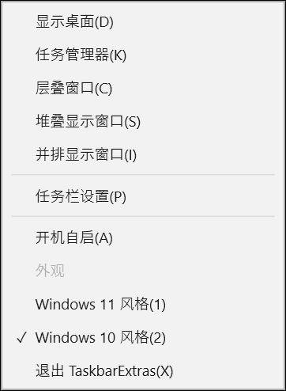
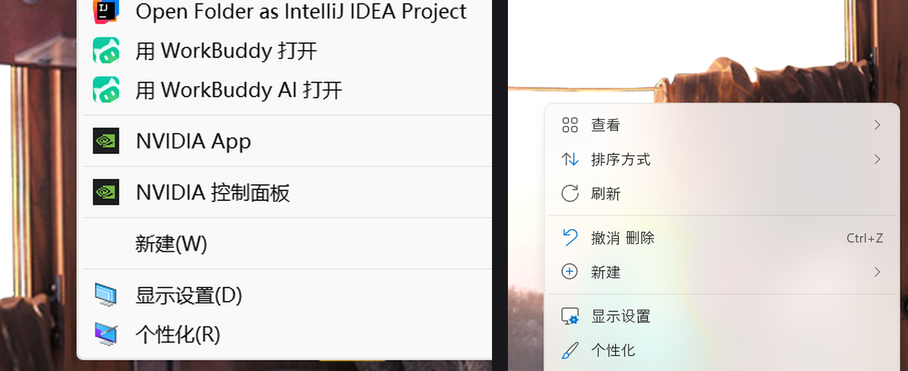
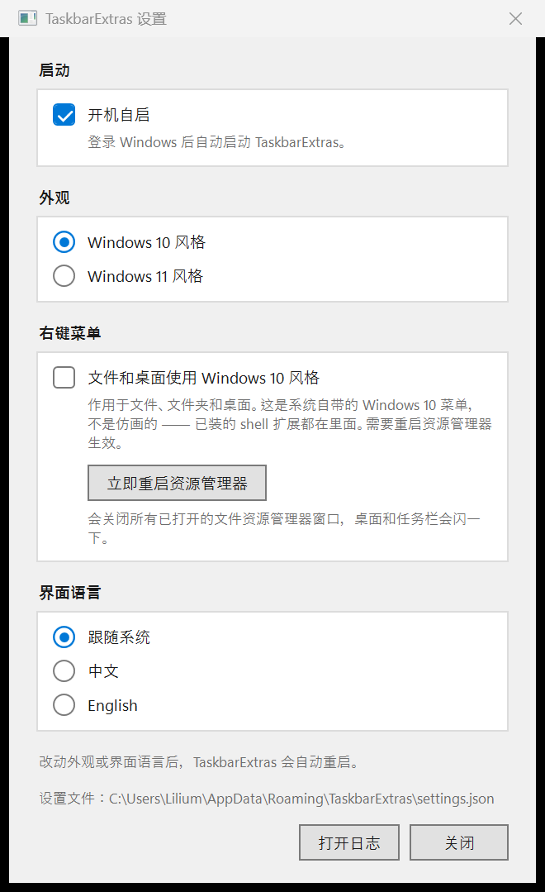
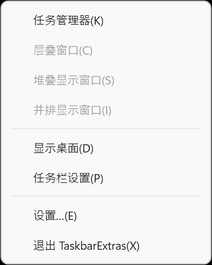
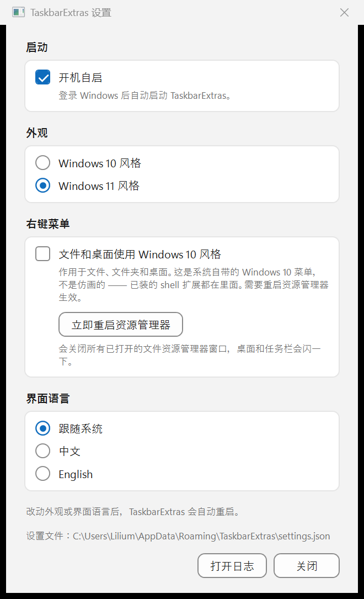

# TaskbarExtras

[English](README.en.md) · **简体中文**

把 Windows 11 删掉的任务栏右键菜单补回来。



## 起因

那天我左手端着快乐水，右手刚离开键盘，想回桌面开个东西。

按 `Win+D` 得腾出手，我没有。于是很自然地右键任务栏，准备点「显示桌面」。

结果这个选项没了。

微软你在干什么啊 😡

行，我自己加回来。 ε=( o｀ω′)ノ

## 能干嘛

右键任务栏的空白处：

| | |
|---|---|
| 任务管理器 | |
| 层叠窗口 | |
| 堆叠显示窗口 | |
| 并排显示窗口 | |
| 显示桌面 | 最小化所有窗口，再点一次还原 |
| 任务栏设置 | |
| 设置… | 打开本程序的设置面板 |
| 退出 TaskbarExtras | |

上面前六项是还原 Win10 任务栏菜单的本体功能，分两组：前四项是**重排已打开的窗口**，分隔线之后的「显示桌面 / 任务栏设置」是另一组 —— 前者把窗口全部收起来，后者是设置入口。**设置… / 退出**是 Win10 没有的，放在最后一条分隔线之后。

> 关于「还原度」的一点实话：Windows 10 真实的任务栏右键菜单是 `工具栏 / 搜索 / 显示"任务视图"按钮 / 显示打开的窗口 / 任务管理器 / 锁定任务栏 / 属性`，管的是**系统开关**，一项目录排列都没有。本项目实现的是**窗口排列**那套（更接近 Win7 时代的任务栏菜单），所以外形上并不逐项对应 —— 这是功能取向的选择，不是遗漏。

只有任务栏**空白处**会被拦截。右键开始按钮还是 Win+X，右键任务图标还是跳转列表，右键托盘图标还是各自的菜单 —— 这些都没动。

## 顺手把文件/桌面的右键菜单也换回 Win10

Win11 把文件和桌面的右键菜单也重做了：一个漂亮的圆角毛玻璃卡片，但常用项目藏在「显示更多选项」里，**快捷键字母也不显示**。这个也能换回去，设置面板里一个勾：

| win10 经典（勾上） | win11 新式（默认） |
|---|---|
|  | |

| | |
|---|---|
| 背板 | 不透明灰、直角 vs 毛玻璃、圆角 |
| 快捷键字母 | 显示 `新建(W)` / `显示设置(D)` / `个性化(R)` vs 不显示 |
| 第三方扩展 | 全彩图标 + 文字 vs 小图标行 |

**这个菜单是系统自己的，不是我画的。** 所以 7-Zip、Git、杀软装的那些扩展条目一个不少，而且长得和 Win10 一模一样 —— 因为它就是 Win10 那个菜单。

**改完要重启资源管理器**（设置面板里有个按钮，会先问一句）—— 会关掉你所有打开的文件夹窗口，桌面黑一秒。

> 实现方式一句话：Win11 画这个菜单靠一个 COM 组件，在注册表的**用户区**放一个同名空条目把它顶掉，系统就回落到经典菜单了。这就是 **Shift+右键**临时调经典菜单用的同一个机制，只是这里做成了持久的。没有注入、没有 hook，随时能删掉改回去。

## 设置

菜单里的「设置…」打开一个普通的设置窗口：



三组：**启动**（开机自启）、**外观**（Win11 / Win10 风格）、**右键菜单**（文件和桌面用 Win10 风格）、**界面语言**（跟随系统 / 中文 / English）。改外观或语言会**自动重启**，原因见下面「皮肤」那节；右键菜单那个要重启资源管理器，面板里有按钮。

窗口底部写着设置文件的位置，也有一个「打开日志」。

设置面板本身也跟着皮肤走 —— 选 Win10 风格，面板也是方的、扁的、用 Win10 那支蓝色。

托盘图标的右键菜单里也有「设置…」，是故意重复的：主菜单能不能弹出来取决于鼠标钩子有没有挂上，托盘那条路不依赖它。

## 运行

去 [Releases](../../releases) 下载，或者自己编：

```bash
dotnet publish src/TaskbarExtras.App -c Release -r win-x64 --self-contained true \
  -p:PublishSingleFile=true -p:IncludeNativeLibrariesForSelfExtract=true \
  -p:EnableCompressionInSingleFile=true -o publish
```

出来一个 exe，双击就行。不用管理员权限，也不用预先装 .NET。

```
TaskbarExtras.exe                     启动
TaskbarExtras.exe --settings          打开设置面板
TaskbarExtras.exe --quit              让正在运行的实例退出
TaskbarExtras.exe --autostart         看是否已设为开机自启
TaskbarExtras.exe --autostart on|off  开 / 关开机自启
TaskbarExtras.exe --lang zh|en        强制界面语言（默认跟随系统）
TaskbarExtras.exe --skin win11|win10  本次运行的菜单外观
TaskbarExtras.exe --skin-set win11|win10
                                      改默认外观并记住（下次启动生效）
TaskbarExtras.exe --classic-menu      看文件和桌面右键菜单是不是经典样式
TaskbarExtras.exe --classic-menu on|off
                                      开 / 关经典右键菜单
TaskbarExtras.exe --restart-explorer  重启资源管理器（让上面的改动生效）
TaskbarExtras.exe --preview           只显示一次菜单，用来预览皮肤
TaskbarExtras.exe --help              显示说明
```

`--classic-menu` **不会**自动重启资源管理器 —— 那会关掉你所有文件夹窗口，得你自己说了算。

`--settings` 在已有实例运行时只是把请求转交给它，不会起第二个进程。

## 怎么退出

没有主窗口，所以没东西可以关。三条路：

1. 右键任务栏 → 菜单最后一项「退出 TaskbarExtras」
2. 右键托盘图标 → 退出（图标在 `^` 折叠区里，深色方块加三道横杠）
3. `TaskbarExtras.exe --quit`

## 开机自启

右键任务栏 →「设置…」→ 勾上「开机自启」。勾上就是下次登录时自动起来。

命令行也行：

```bash
TaskbarExtras.exe --autostart on
TaskbarExtras.exe --autostart off
```

写的是 `HKCU\Software\Microsoft\Windows\CurrentVersion\Run`，用户级，不需要管理员权限。

有个坑值得说：任务管理器的「启动」页可以禁用启动项，而**它不会删掉 Run 里的值**，只是在另一个地方记一笔。所以只看 Run 键会以为一切正常，实际根本不会启动。这个程序两处都看 —— 你在任务管理器里禁用了，设置面板里的勾就会消失，再点一下能重新生效。

顺带：如果你把 exe 挪到了别的目录，旧的注册项就指向一个不存在的地方。这种情况面板里也显示为未勾选，点一下会重新登记当前路径。

## 皮肤

菜单外观全写在 `ResourceDictionary` 里。加一套皮肤就是加一个 xaml，不用改 C#。

**默认是 win10 风格。** 这个程序的全部意义就是把 Win11 砍掉的东西补回来，那默认就该是你想找回来的那个菜单 —— 不是 Win11 原生那个。留 Win11 风格也有，但默认的话外观太"合群"，看不出程序在跑。

没设置过就用默认值；**已经存过的设置不会被覆盖** —— 升级上来的人选过什么，还是什么。

| win10（默认） | win11 |
|---|---|
|  |  |

### 怎么切换

**右键任务栏空白处 →「设置…」→ 外观 → 选一个。** 选完自己重启。

命令行有两个，区别只在记不记住：

```bash
TaskbarExtras.exe --skin-set win10    # 改默认，记住，下次启动生效
TaskbarExtras.exe --skin win10        # 只管这一次，不改默认
```

选择存在 `%APPDATA%\TaskbarExtras\settings.json`，重启、关机都还在。

**为什么切换要重启？** 皮肤是菜单窗口构造前合并进去的字典，而窗口里的画刷用的是 `StaticResource` —— 只在加载时解析一次，运行中换字典不会生效。想做成即时切换，得把每个画刷引用都改成 `DynamicResource`。重启大概 300ms，比改一遍 XAML 划算。语言同理：菜单每次打开都会重建标签能跟上，但托盘菜单的文字是建图标时定死的，只换一半不如不换。

两套是按各自年代的实物做的，不是同一套换个颜色：

- **win10**：`#F2F2F2` 扁平底、**直角**、更深的灰边框，标签里带快捷键字母 —— `任务管理器(K)` 这种。**那些字母真的能按**，不是画上去好看的。
- **win11**：近白卡片、8px 圆角、柔和阴影、中性灰悬停。

设置面板也吃同一套皮肤，所以两套皮肤下的面板长得不一样：

| win10 下的设置面板（默认） | win11 下的设置面板 |
|---|---|
|  |  |

## 经典右键菜单（文件和桌面）

这是**独立于皮肤**的一个开关 —— 皮肤只管上面那个自绘的任务栏菜单长什么样，这个换的是**系统自己的**文件和桌面右键菜单。

打开之后，右键文件和桌面空白处出来的就是 Win10 那个经典菜单：分节、紧凑、带快捷键字母，**所有第三方 shell 扩展都在**（7-Zip、Git、显卡驱动、杀软……）。因为它不是仿的，是系统另一条路径上那个真的经典菜单。

**它和皮肤是两回事，所以是两个地方。** 皮肤决定「我画的任务栏菜单长什么样」；这个决定「系统的文件菜单走哪条路」。把 Win11 皮肤配经典右键菜单是完全合理的组合，反之亦然。

**生效要重启资源管理器。** 系统会缓存已经解析过的菜单处理器，改完注册表不重启的话菜单可能不变 —— 设置面板里有个「重启资源管理器」按钮，点了会先确认一次（会关掉所有打开的文件夹窗口）。

**怎么实现的**（不注入、不 hook）：Win11 画这个菜单靠一个 COM 组件，在注册表的**用户区**（`HKCU`）放一个同名空条目就能把它顶掉，系统找不到就把经典菜单调出来。这正是 **Shift+右键**临时调经典菜单用的同一个机制，本程序只是把它做成了持久的。

一句话取舍：Win11 那套菜单是画在 shell 合成层上的**像素，不是 Win32 菜单对象** —— 没有 `HMENU` 可以拿，所以「调出来再改外观」这条路根本不存在，能做的只有「让系统走经典那条路」。

## 原则

**不注入任何进程。** 不往 `explorer.exe` 里塞 DLL，不打补丁，不改系统文件。它就是个普通进程，关了什么都不留。

**只用文档化 API。** 拦截右键用 `WH_MOUSE_LL`（跑在自己进程里），窗口排布用 `IShellDispatch`，任务栏位置用 `SHAppBarMessage` 和 `GetMonitorInfo`。没有私有结构体偏移，也没有特征码扫描。

原因很实际：靠注入实现的工具，每次 Windows 更新都得跟着改，没跟上就整个坏掉。实测数据和推演过程在 [docs/DESIGN.md](docs/DESIGN.md)。

## 下一步

- [ ] 菜单加动画（淡入、滑出）
- [ ] 做更多样式
- [ ] 皮肤即时切换（把画刷引用改成 `DynamicResource`，省掉重启）
- [ ] Windows 10 风格的开始菜单
- [ ] 恢复磁贴


## 已知问题

- 只在单屏 150% 缩放上测过。双屏和混合 DPI 未验证。
- 右键到菜单出来有约 40ms 延迟 —— 鼠标钩子拦下右键再渲染，这个开销不可避。
- 换皮肤或界面语言要重启进程才能生效（原因见上面「皮肤」一节）。
- 换经典右键菜单要重启资源管理器才能生效。这个开关在 26H2（Build 26300.9457）上实测可用，更早或更晚的版本未验证。
- 没做和其他任务栏工具的兼容，一起装可能打架。
- 区分「右键的是任务栏空白处还是应用按钮」要靠 UI Automation（Windows 11 的任务按钮是 XAML 画的，位置不在窗口树里）。它每秒刷新一次快照。万一 UIA 读不到，会退回旧的窗口树判定，那种情况下在 Windows 11 上可能误判。
- 字母快捷键要求菜单能拿到键盘焦点。绝大多数情况没问题；万一拿不到（日志里会写一行警告），字母不响应，但鼠标点击照常。

## 许可

MIT。
